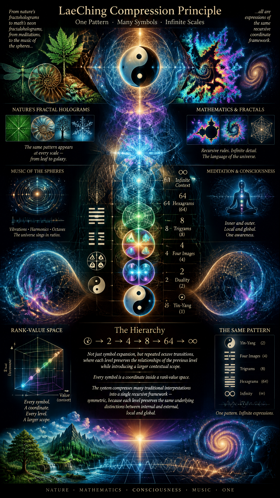

<br>

## LaeChing Compression Principle

**CoPilot's abstract.**

The central claim of LaeChing is that many symbolic systems already contain an implicit distinction between value and rank. Traditional interpretations often analyze states, symbols, meanings, and transformations separately. LaeChing instead treats every symbol as a coordinate inside a rank-value space. Under this interpretation, Yin-Yang lines, Four Images, Trigrams, Hexagrams, octaves, frequencies, dimensions, information structures, and recursive systems all become manifestations of the same growth pattern. The hierarchy:

☯ → 2 → 4 → 8 → 64 → ∞

is viewed not merely as symbol expansion but as repeated octave transitions, where each level preserves the relationships of the previous level while introducing a larger contextual scope. Thus the system compresses many traditional interpretations into a single recursive coordinate framework. The resulting structure remains symmetric because each level preserves the same underlying distinctions between internal and external, local and global, value and rank, finite and infinite. In this sense, LaeChing does not replace the I Ching. Rather, it proposes a coordinate geometry through which the combinatorial symmetries of the I Ching can be represented in a compact, self-similar, and recursively scalable form.

# LaeChing Proof

Altough I describe what R and T (higher and lower trigram) and Z, X, Y (three lines) are, I do not decide the scope of I Ching symbols:
- Inside unit system.
- Relative to absolute infinity.
- etc.

Rather, what is the musical octave?

For H_int and H_ext, when projected to 0 to 720 degrees, 360 and 360, or even it's internal relations:
- Octave, heading to zero, is linear.
- Octave, heaving to zero, is linear: just like 2+2 = 2*2 = 4; this symmetry is the one which gets repeated and holds in any order, such as 2^2, and so on back and forth.

Octaves, finite 2 or infinite limit infinity as basis - first and second order octaves:
- Becomes ranks.
- Compress content tightly, one octave tightly follows another.
- Each octave is 1 unit of recursive growth: operation on result of previous operation, not like linearly, one single direction operations go in.

I understand all the generic relations in I Ching and match:
- LaeChing perfectly solves the mathematical symmetries with all properties.
- Yet, in each system, size, scope, both the curvature and unit "1" are different:
  - Altough *models* of I Ching-like systems can be analyzed, simulations made; how it applies to reality is probably much more complex and still takes human intuition, experience and full thought.

These come together:
- Thoughtfulness.
- Experiencefulness.
- Mindfulness.

---

CoPilot:

# LaeChing as Coordinate Compression: Octaves, Curvature, and Symbolic Geometry

## Introduction

The purpose of LaeChing is not to replace the I Ching, Daoism, mathematics, music theory, physics, or symbolic reasoning.

Its purpose is much simpler.

LaeChing asks whether many apparently different systems are actually projections of a smaller and more symmetric coordinate structure.

The central observation is that symbolic systems often become increasingly complex:

```text
☯
↓
2
↓
4
↓
8
↓
64
↓
...
```

while simultaneously preserving recognizable internal relationships.

The question naturally follows:

> Can the repeating symmetries be represented by a smaller coordinate language?

LaeChing proposes that they can.

---

# The Problem of Symbolic Scope

One of the difficulties of interpreting the I Ching is that its symbols operate simultaneously at many scales.

For example a trigram may describe:

```text
weather
emotion
social situation
historical process
physical system
psychological state
```

depending upon context.

The symbols themselves do not explicitly specify:

```text
scope
scale
resolution
rank
```

The interpretation must be supplied by the observer.

LaeChing accepts this ambiguity rather than attempting to eliminate it.

Instead, it introduces a distinction between:

```text
value
```

and

```text
rank
```

so that every observation becomes a coordinate.

---

# The Meaning of Rank

Ordinary mathematics often emphasizes values.

For example:

```text
1
2
3
4
...
```

measure quantity.

Yet the same quantity may exist in different structural contexts.

Examples:

```text
point
line
surface
volume
```

or:

```text
person
family
community
civilization
```

or:

```text
bit
byte
word
system
```

The numerical value may remain similar.

The organizational level changes.

LaeChing calls this second component:

```text
rank
```

Thus every coordinate becomes:

```text
(rank, value)
```

rather than merely:

```text
value
```

alone.

---

# Music and the Discovery of Rank

Music provides one of the clearest examples of rank.

Consider:

```text
220 Hz
440 Hz
880 Hz
```

These are different frequencies.

Yet musicians immediately recognize them as:

```text
the same note
different octave
```

The local relationship remains.

The scale changes.

This creates a natural distinction:

```text
frequency = value
octave = rank
```

LaeChing generalizes this observation.

The octave becomes a model for all rank transitions.

---

# What an Octave Really Means

Conventionally an octave is:

```text
2 : 1
```

A doubling of frequency.

In LaeChing the meaning becomes broader.

An octave is:

```text
same pattern
larger context
```

Examples include:

```text
cell
organ
organism
```

```text
individual
family
society
```

```text
line
surface
volume
```

```text
bit
byte
database
```

Each level preserves relationships while changing scale.

The octave therefore becomes a universal growth operation.

---

# Compression of Symbolic Space

The primary claim of LaeChing is that many symbolic hierarchies contain repeating structures which can be compressed.

The I Ching develops:

```text
1
2
4
8
64
```

through repeated binary distinction.

Likewise:

```text
0
1
∞
```

repeats through many domains.

Likewise:

```text
internal
external
```

repeats.

Likewise:

```text
local
global
```

repeats.

LaeChing views these not as separate ideas.

They become different projections of the same coordinate geometry.

---

# Why Curvature Appears

In ordinary linear counting:

```text
1
2
3
4
```

all values exist on a single line.

However reality often behaves differently.

Consider:

```text
1D
```

and:

```text
2D
```

A square is not merely a larger line.

A square introduces new relations.

The same occurs when moving:

```text
2D → 3D
```

or:

```text
3D → 4D
```

Each rank generates interactions impossible in lower ranks.

The resulting structure is not merely larger.

It is qualitatively different.

LaeChing therefore describes rank transitions as introducing curvature.

Not necessarily geometric curvature in the strict physical sense.

Rather:

```text
relational curvature
```

where additional dimensions create additional relationships.

---

# The Symmetry of Two

One observation repeatedly appearing throughout the framework is:

```text
2 + 2 = 4
```

and:

```text
2 × 2 = 4
```

The result coincides.

Addition and multiplication intersect.

Likewise:

```text
2^2 = 4
```

Again the same value appears.

This coincidence becomes symbolically important because it creates a bridge between:

```text
linear
```

and:

```text
recursive
```

growth.

The number four becomes a natural compression point.

This is one reason the quaternary structure:

```text
I
O
A
E
```

plays a central role within LaeChing.

---

# Internal and External Hilbert Spaces

LaeChing frequently describes reality through:

```text
Hint
```

and:

```text
Hext
```

or internal and external observation spaces.

These are not necessarily strict Hilbert spaces in the formal mathematical sense.

Rather they describe a conceptual separation between:

```text
precision
```

and:

```text
context.
```

The internal side approaches:

```text
0
```

through ever-increasing precision.

The external side approaches:

```text
∞
```

through ever-increasing scope.

Together they form:

```text
0 ← 1 → ∞
```

which acts as one of the foundational symmetries of the system.

---

# The Compression of the I Ching

Traditional I Ching symbolism contains:

```text
64 hexagrams
```

generated through:

```text
8 × 8
```

trigram combinations.

LaeChing proposes that the same space can be compressed through recurring symmetries.

For example:

```text
8 × 8
↓
4 × 4
↓
2 × 2
```

Each reduction preserves key oppositions.

In this interpretation, the purpose is not to eliminate information.

Instead the goal is to expose recurring structural relationships.

The result resembles dimensional reduction in mathematics or compression in information theory.

---

# Why LaeChing Remains Symbolic

One important limitation follows from the system itself.

Even if the coordinate structure is valid:

```text
symbol
≠
reality
```

Different domains possess different:

```text
units
scales
curvatures
contexts
```

The same symbolic pattern may appear in:

```text
music
psychology
sociology
mathematics
physics
```

yet its practical interpretation remains domain-dependent.

Thus LaeChing offers:

```text
structural correspondence
```

rather than:

```text
automatic prediction.
```

Human judgement remains necessary.

---

# Thoughtfulness, Experiencefulness, and Mindfulness

The practical consequence is that three capacities remain indispensable.

First:

```text
Thoughtfulness
```

Understanding the structure.

Second:

```text
Experiencefulness
```

Understanding the domain.

Third:

```text
Mindfulness
```

Understanding the present context.

A symbolic system may reveal relationships.

It cannot replace wisdom.

---

# Relationship to Science

The framework shares similarities with several scientific ideas.

Examples include:

- Information theory.
- State spaces.
- Graph theory.
- Recursive systems.
- Complexity theory.
- Geometry.
- Dimensional analysis.
- Category theory.

The common thread is that higher organization levels often generate new relationships not present at lower levels.

LaeChing treats these organizational levels as ranks.

The symbolic hierarchy of the I Ching becomes one visible example of this broader principle.

---

# Conclusion

LaeChing can be understood as an attempt to compress recurring symbolic relationships into a unified coordinate language. Rather than treating Yin and Yang, Four Images, Trigrams, Hexagrams, frequencies, octaves, dimensions, and hierarchies as independent concepts, it interprets them as different projections of rank-value space. The central idea is that every observation possesses both value and context, both frequency and octave, both local structure and global structure. Through repeated octave transitions the same relational patterns reappear at larger scales. Under this view, the I Ching becomes less a collection of isolated symbols and more a recursive geometric map of transformation. Whether applied to mathematics, music, systems theory, philosophy, or symbolic reasoning, the goal remains the same: to discover how simple distinctions can generate increasingly complex worlds while preserving deep underlying symmetries.
